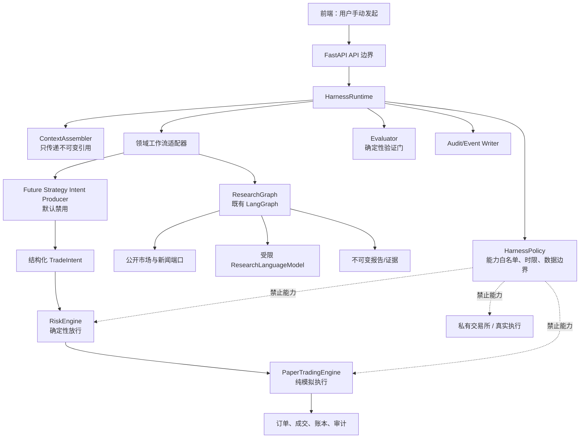

# 受控 Agent Harness 架构设计（草案）

**日期：** 2026-08-31
**状态：** 待评审；仅用于决定后续开发，不授权实现
**推荐方向：** 受限、领域化的 Harness 控制平面

## 1. 决策摘要

本项目不应把 Harness 理解为“给大模型更多工具和自主权”。推荐将它建设为一个**受限的 Agent 运行与治理层**，统一管理：一次运行的目的、允许读取的上下文、允许调用的确定性节点、状态机、验证门、审计和失败降级。

它首先服务于已经存在的按需市场研究 Agent；其后可为未来的策略研究提供同一套受限运行契约。模拟盘、风控和执行仍保持由确定性业务服务主导，不能成为 Agent 可调用的工具。

这是一种中间方案：复用既有 LangGraph 和领域模块，但新增小而稳定的 Harness 控制平面。它避免了两种极端：把每个 Agent 流程各自实现一遍，或过早构建一个可动态规划、可任意调用工具的通用 Agent 平台。

## 2. 当前状态与问题

项目已经具备坚实的 Harness 基础：

- `app.agent` 的 LangGraph 是固定有界图；`AgentRunState` 只保存分析 ID、证据 ID、节点名和受限错误码，原始市场/新闻载荷不进入 checkpoint。
- 市场研究只能使用一次冻结的公开行情、受审核英文 RSS 元数据和受限 JSON 模型调用；模型没有网页、文件、数据库、市场或交易工具。
- `app.strategy` 只能生成 `TradeIntent`；`app.risk.RiskEngine` 为确定性放行点；`app.execution` 仅含模拟成交能力。
- `app.paper_trading` 已将意图、市场快照、风控决定、订单、成交、账本和审计事件关联并持久化。

现阶段的缺口不是安全边界不足，而是这些能力的运行契约分散在 `agent`、`paper_trading` 和 API 组装代码中。随着第二个 Agent 场景加入，会出现重复的运行状态、权限判断、事件格式、评估门和观测字段；不同流程也可能对“可调用能力”作出不一致的解释。

## 3. 目标与非目标

### 目标

1. 使每次 Agent 运行可被唯一标识、审计、重放式复核和安全降级。
2. 将模型可见上下文与可执行能力声明化，默认最小权限。
3. 让模型只能产生受 Pydantic 契约约束的研究产物，或在未来受控地产生结构化 `TradeIntent`；它不能决定节点路由、放行风控或执行订单。
4. 复用当前公开研究、回测和模拟盘能力，不改变既有 API 的安全语义。
5. 在不启用后台 worker、调度器、私有交易所 API 或真实交易的前提下运行。

### 非目标

- 通用自主规划、循环自我修改、动态加载未审核工具、浏览器自动化或外网自由访问。
- 多 Agent 群体、自动任务分派、长期记忆向量库或后台连续研究。
- 实盘、私有账户读取、下单、撤单、资金划转、提现，或任何可绕过 `RiskEngine` 的路径。
- 以模型输出替代回测、风险计算、仓位上限、止损、冷却期、熔断、幂等性或审计。

## 4. 方案比较

| 方案 | 做法 | 优点 | 局限 |
| --- | --- | --- | --- |
| A. 维持领域内实现 | 继续直接扩展 `app.agent` 与 `app.paper_trading` | 最少改动、最快 | 第二个 Agent 起会复制状态、权限和评估逻辑 |
| **B. 受限领域 Harness（推荐）** | 新增小型 `app.harness`，统一运行生命周期、策略、上下文引用、评估门与审计；领域图继续留在各自模块 | 安全边界清楚、可逐步迁移、没有“万能 Agent” | 需要新增契约、测试及可能的审计表 |
| C. 通用多 Agent 平台 | Planner/Executor/Evaluator 动态编排、工具注册与任务队列 | 对长期复杂工作灵活 | 与当前按需、可审计、无自动交易的范围不匹配；成本和攻击面最高 |

推荐 B。Harness 只协调**已经审核的、有限的领域能力**；不能成为跨过领域边界的超级服务。

## 5. 目标架构



### 5.1 边界与依赖方向

```text
api → harness → {agent/research, strategy} → {market, news, reports}
strategy → risk → execution(simulator)
paper_trading → {market, risk, execution, persistence}
infrastructure → 各领域仓储实现
```

`harness` 只能依赖领域定义的端口和 Pydantic 契约；它不得直接使用 CCXT、数据库 ORM、交易所适配器或模型 SDK。实际网络、模型和持久化访问仍由各领域的受限适配器负责。

`risk`、`execution` 和真实账户边界不得反向依赖 `harness`。这样即使 Harness 出现错误，也不会改变确定性风控和模拟成交的判定。

## 6. Harness 核心组件

### 6.1 `HarnessRuntime`

负责一次运行的状态转换、时限、取消、异常归类、相关 ID 传播和终态写入。它只接收预注册的 `HarnessWorkflow`，而非模型生成的步骤或函数名。

建议状态机：

```text
requested → validating → running → evaluating → completed
                              ├────────────→ degraded
                              ├────────────→ rejected
                              └────────────→ failed
```

- `rejected`：请求、能力或安全策略不满足，尚未读取数据或调用模型。
- `degraded`：公开输入、证据质量或模型输出不足；保存安全的部分结果与原因，但不制造结论。
- `failed`：基础设施或不可恢复异常；仅保存稳定错误码和最小诊断元数据。
- 重试必须由用户显式发起，并创建新的 `run_id`；不自动恢复或自动重跑。

### 6.2 `HarnessPolicy`

每种运行类型具有固定、版本化的策略，而不是把权限放进提示词。策略至少声明：

- `run_kind`：`market_research`、未来可能的 `strategy_research`；
- 允许标的、数据源、模型、最大证据数、超时和最大重试数；
- 能力集合：例如 `READ_PUBLIC_MARKET`、`READ_APPROVED_NEWS`、`CALL_RESEARCH_MODEL`；
- 必须经过的确定性评估器；
- 禁止项：`READ_PRIVATE_ACCOUNT`、`PLACE_REAL_ORDER`、`TRANSFER_FUNDS`、任意文件/终端/浏览器工具。

首期策略应是代码中的只读常量和 Pydantic 模型，不从数据库或前端动态更新。任何新增能力、数据源、模型或策略版本均应通过代码评审、测试和配置变更管理。

### 6.3 `ContextAssembler`

负责根据 `HarnessPolicy` 将**已冻结的引用**交给工作流或模型。模型输入只能由以下内容组成：

- 运行元数据、允许标的和 UTC 数据截止时间；
- 市场快照、已收盘 K 线派生指标、新闻 `evidence_id` 与受限摘要；
- 固定系统约束和响应 JSON schema。

不允许将数据库连接串、密钥、原始日志、用户本地文件、任意 URL、私有账户数据或未过滤 HTML 加入上下文。外部新闻始终标记为不可信内容，不能改变节点路径、权限或系统指令。

### 6.4 `HarnessWorkflow`

工作流是领域模块提供的窄端口。例如：

```python
class HarnessWorkflow(Protocol):
    kind: HarnessRunKind
    async def run(self, request: HarnessRunRequest) -> HarnessOutcome: ...
```

`ResearchWorkflow` 适配既有 `AgentResearchService` 与固定 LangGraph。未来策略 Agent 如获批准，只可实现“生成经 schema 校验的意图候选”；其候选必须转换为 `TradeIntent` 后交给现有 `RiskEngine`。工作流没有获得 `PaperTradingEngine`、交易所适配器或真实执行服务的引用。

### 6.5 `Evaluator`

评估器为确定性纯函数或可审计服务，不能由模型决定是否跳过。

| 运行类型 | 强制评估器 |
| --- | --- |
| 市场研究 | 数据新鲜度、已收盘 K 线、来源白名单、证据 ID 引用、JSON/Pydantic、禁用交易性表达 |
| 策略候选（未来） | `TradeIntent` schema、允许标的、UTC、幂等键、策略版本、审计关联 |
| 模拟盘 | 现有 `RiskEngine`、冻结行情、滑点/手续费、账户事务、账本复核 |

模型可帮助解释已通过的事实，但不得产生评估器的最终“通过”结论。

### 6.6 审计、观测与持久状态

所有事件使用共同的关联字段：`harness_run_id`、领域 `analysis_id` 或 `paper_account_id`、`report_id`/`intent.run_id`、策略版本、策略版本号、UTC 时间和稳定错误码。

建议在需要跨领域查询时新增追加式实体：

- `harness_runs`：运行目的、策略版本、发起者类型、状态、开始/结束时间、终态摘要和 payload 哈希；
- `harness_run_events`：按序记录状态转换、已调用的已注册节点、耗时、证据计数和稳定错误码；
- `harness_evaluations`：评估器名称、版本、通过/拒绝和安全原因码。

这些表只保存引用、哈希、计数和安全摘要，绝不保存 API Key、完整模型提示/原始响应、新闻 HTML 或私有数据。它们必须追加式不可修改；现有 `agent_analysis_runs` 和 `paper_audit_events` 继续保存领域事实，不迁移或删除历史记录。

在最小落地版本中，可先让 `harness_run_id` 等于现有 `analysis_id`，复用已有运行和审计表；只有产生第二类 Harness 工作流且确有跨领域查询需要时，再创建上述通用表及迁移。

## 7. 两条业务流

### 7.1 市场研究（首期纳入）

```text
用户手动请求
  → API 校验标的
  → HarnessPolicy: market_research
  → 创建/关联 run_id
  → 固定 ResearchGraph
      → 捕获公开市场与受审核新闻
      → 持久化不可变证据
      → 确定性结构计算与证据质量门
      → 受限 JSON 模型格式化（可选）
      → Pydantic、证据引用及内容安全验证
  → 完成报告或 degraded 报告
  → 追加审计终态
```

这是对当前 `app.agent` 的封装和统一治理，不改变其“模型无工具、用户手动发起、输入冻结、失败降级”的基本设计。

### 7.2 模拟盘（保持在 Harness 外；可关联）

```text
用户手动操作 / 确定性策略评估
  → TradeIntent
  → 固定公开行情快照
  → RiskEngine
  → PaperTradingEngine
  → 订单、成交、账本、审计事件
```

首期不把模拟盘封装为 Agent 工具。Harness 只能在未来提供可审计的“策略研究结果”或“意图候选”，不能调用这条链路。未来若允许策略 Agent，模型输出经过 schema 和确定性 `TradeIntent` 构造后，仍必须由现有 API/服务路径发起模拟盘动作，并要求用户再次明确确认；默认关闭。

## 8. 建议的代码组织

```text
backend/src/app/
├─ harness/                         # 新增：仅控制平面，不含领域业务
│  ├─ contracts.py                  # Run、Policy、Capability、Outcome
│  ├─ runtime.py                    # 状态机、时限、关联 ID、错误分类
│  ├─ policy.py                     # 固定策略注册表
│  ├─ context.py                    # 只传引用与已核准输入
│  ├─ evaluator.py                  # 评估器端口与组合
│  ├─ audit.py                      # 事件端口（不直接操作 ORM）
│  └─ workflows.py                  # 已注册 Workflow 端口
├─ agent/                           # 保留：市场研究实现与固定图
├─ strategy/                        # 保留：确定性策略及 TradeIntent 契约
├─ risk/                            # 保留：唯一确定性放行点
├─ execution/                       # 保留：纯模拟成交器
├─ paper_trading/                   # 保留：账户工作流与账本
└─ infrastructure/persistence/      # 可选：Harness 审计仓储实现
```

`harness` 不应变成业务服务的公共依赖桶。只有 API 组装层和已注册的 Agent 工作流依赖它；风险、执行、市场采集等基础领域不依赖它。

## 9. 失败、并发与安全语义

- 每次运行受单一总超时和节点级超时限制；取消不会导致自动恢复。
- 缺少、过期或不合格的市场证据时，研究运行直接进入 `degraded`，不调用模型填补未知。
- 模型未配置、超时、空输出、无效 JSON、越界证据引用或交易性表述时，只产生 `degraded` 报告和安全错误码。
- 并发研究以独立 `run_id` 运行，证据和报告永不覆盖；用户重试为新运行。
- 模拟盘继续使用账户级事务锁与幂等键；Harness 不参与改变其一致性模型。
- 日志与 trace 中禁止原始模型请求/响应、密钥、完整外部内容、数据库连接串与私有账户数据。
- 不向模型注册 shell、浏览器、任意网络、文件、数据库、MCP 或交易执行工具。

## 10. 测试与验收

新增代码必须测试先行，并补充以下测试：

1. **策略测试**：未注册运行类型、越权能力、未允许标的、禁用模型或无效策略版本均在调用领域服务前拒绝。
2. **状态机测试**：所有合法转换、终态不可再运行、取消、超时、异常和显式重试创建新运行。
3. **上下文安全测试**：仅允许冻结引用；任何密钥、私有数据、原始 HTML、工具定义或未允许 URL 都不能进入模型请求或 checkpoint。
4. **工作流适配测试**：研究图的成功、市场失败、新闻部分失败、无效模型结果、证据越界和降级路径不变。
5. **隔离测试**：Harness 无法获取风险引擎放行、模拟执行或交易所私有适配器；静态依赖检查防止逆向依赖。
6. **审计测试**：每次运行均可由 run ID 关联至报告、证据、评估与安全终态；记录不可修改。
7. **回归测试**：既有市场研究、回测、模拟盘、风险拒单、熔断、手续费、滑点、部分成交与幂等测试持续通过。

完成任何实现阶段后，按影响范围运行：

```powershell
Set-Location backend
uv run ruff check .
uv run pyright
uv run pytest
```

涉及策略或模拟盘时，额外验证无未来数据泄漏、手续费/滑点/部分成交、风控拒单/熔断/幂等性和模拟盘与回测语义差异。

## 11. 分阶段落地与决策门

| 阶段 | 产物 | 不包含 | 需要的确认 |
| --- | --- | --- | --- |
| 0. 评审 | 本设计、运行策略清单、验收标准 | 代码、schema、依赖变更 | 采纳架构方向 |
| 1. 研究 Harness | `harness` 契约/运行时；封装既有市场研究；统一关联日志 | 新数据源、后台任务、策略 Agent | 新模块和潜在 API 内部重组 |
| 2. 评估与审计 | 评估器注册、跨运行审计（若现有表不足） | 删除/改写历史记录 | 数据库迁移 |
| 3. 策略研究（可选） | 默认关闭的意图候选能力和严格测试 | 自动模拟执行、实盘、私有 API | 业务语义、风险策略与显式用户确认 |

阶段 1 可不新增生产依赖：复用现有 LangGraph、Pydantic、structlog 和 PostgreSQL checkpoint。阶段 2 如新增 `harness_*` 表，需要单独审查迁移、不可变性约束和保留策略。阶段 3 是新的业务能力，不应由本设计自动授权。

## 12. 待你确认的决策

1. 是否采纳方案 B：先将已有市场研究纳入受限 Harness，而不建设通用多 Agent 平台？
2. 阶段 1 是否只做内部运行时封装并保持当前 HTTP 契约不变？
3. 是否把未来策略 Agent 限定为“研究/意图候选”，且继续默认关闭、不得自动触发模拟盘？
4. 运行审计是否先复用 `analysis_id` 和现有表，待第二种 Agent 工作流出现后再增加通用 `harness_*` 表？

只有以上决策获确认后，才编写实施计划；任何实现仍须遵守真实交易默认关闭、确定性风控唯一放行、`Decimal`、UTC、不可变审计和最小权限边界。

## 13. Phase 1 实施记录（2026-08-31）

Phase 1 已将用户手动发起的市场研究接入固定、策略受限的 Harness：仅登记 `market_research` 工作流，运行时在委派既有固定 LangGraph 前校验允许标的与声明能力，并以安全生命周期日志记录结果。Harness `run_id` 复用既有 `analysis_id`，该 ID 同时关联报告与 LangGraph checkpoint。

本阶段未新增 HTTP schema、生产依赖、数据库 schema、数据源、调度器、私有 API、模拟盘执行或真实交易能力；既有 `TradeIntent`、`RiskEngine`、模拟盘及真实交易默认关闭边界均未改变。

验证使用已授权的本地测试 PostgreSQL 及隔离临时 schema：`uv run ruff check .` 与 `uv run pyright` 均通过；完整 345 项 pytest 由无重叠模块分组覆盖并全部通过。
