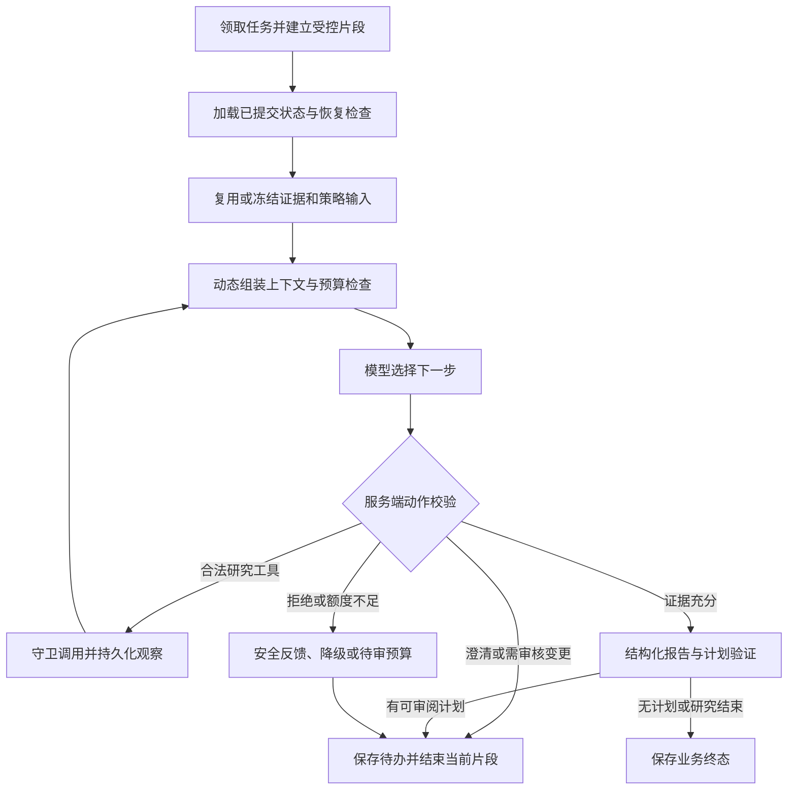

# 交互式研究 AI Agent 目标架构设计

- 版本：1.1
- 日期：2026-11-06
- 状态：设计审阅稿；需求基于[升级需求 v1.0](2026-11-06-interactive-research-agent-requirements.md)，不代表功能已经实施或本设计已获逐项批准。
- 本轮交付：目标架构、关键协议、可靠性与权限边界、规范变更方案、分期及验收映射；v1.1 补充 Harness 职责、运行不变量、故障分类和开发计划追踪要求。
- 本轮不执行：功能开发、依赖安装、数据库迁移、业务配置修改、部署或真实模型调用。

## 1. 设计目标与约束

构建一个可自主研究、可使用工具和知识、可解释过程、可与用户协作的研究 Agent。市场报告、决策评估和条件计划共享证据，但分别表达质量与审核状态。研究侧不生成 TradeIntent、不访问真实账户、不调用风控放行或模拟/真实订单服务。

已经对齐的行为是：用户发起任务后，Agent 在授权范围内自主研究；澄清、关键参数和策略变更、范围与预算扩大、计划采纳及重大修订触发交互或审核；持续监控可选且默认关闭。具体 MACD、三重过滤等算法后续单独讨论。

本文中的包名、状态、数值限制和协议是架构设计建议，不冒充用户逐项指定的决定。后续实施计划应把它们落实为一致的类型、数据库约束和测试。设计可以分期实现，但只有完成全部核心闭环后才能宣称完整 Agent 目标已交付。

### 1.1 现状依据

- [根目录规范](../../../AGENTS.md)、[后端规范](../../../backend/AGENTS.md)、[前端规范](../../../frontend/AGENTS.md)。
- [AI 维护指南](../../ai-maintenance.md)、[运行边界](../../operational-boundaries.md)、[技术交易计划书](../../technical-trading-plan.md)。
- [现有固定图](../../../backend/src/app/agent/graph.py)、[综合服务](../../../backend/src/app/agent/service.py)、[技术 worker](../../../backend/src/app/agent/technical/worker.py)。
- [Harness 契约](../../../backend/src/app/harness/contracts.py)、[运行时](../../../backend/src/app/harness/runtime.py)、[审计](../../../backend/src/app/harness/audit.py)。
- [技术任务仓储](../../../backend/src/app/infrastructure/persistence/technical_run_repository.py)、[技术方法](../../../backend/src/app/agent/technical/methods.py)、[技术计算](../../../backend/src/app/agent/technical/engine.py)。

当前技术队列只按币种合并活跃请求，模型适配器拒绝工具调用，Harness 审计使用固定四阶段，综合图大载荷保留在请求对象。新设计分别处理这些约束，不把 checkpoint 或旧任务恢复等同于新交互任务已经可恢复。

### 1.2 v1.1 更新范围

本版保留[需求 v1.0](2026-11-06-interactive-research-agent-requirements.md)的目标、默认审核规则及可选监控范围，不增加具体策略算法、交易能力或新的用户前置物料要求。新增内容用于将 Harness 的工程原则转为可分工、可测试的实施计划输入；不宣称获得某个跨框架统一认证，也不代表现有代码已完成这些能力。

## 2. 方案比较与采用方向

| 方案 | 优点 | 主要代价 | 本文选择 |
| --- | --- | --- | --- |
| 直接改造旧综合图和技术报告契约 | 入口较少 | 动态交互、旧报告数值门禁及同步兼容相互耦合，回归面大 | 保留旧路径，逐步复用领域能力 |
| 在模块化单体中新增交互式研究路径 | 沿用数据、数据库、图框架和部署，能清楚区分新旧契约 | 增加任务、交互和策略/知识领域模型 | 采用，延续需求中的技术方向 |
| 新建独立 Agent 平台或多 Agent 服务 | 运行隔离较强 | 重复网关与编排、增加网络与运维边界，当前无必要性证据 | 不纳入核心版 |

采用单研究 Agent、显式 LangGraph、PostgreSQL 持久任务与事件、内部领域工具和经治理 MCP。API 只入队、读取及接收反馈；图负责模型循环；`app/harness/` 治理内核负责准入和审计；工具网关负责逐次调用治理。系统级 Harness 由这些模块与上下文、预算、恢复及审核机制共同构成，具体划分见第 3.1 节。应用服务管理业务状态与队列，不另写模型推理循环或第二套图调度引擎。

本地核心版可以继续由 API lifespan 启动独立任务消费者，复用现有租约模式。保留同代码库独立 worker 入口的演进空间，首期不强制新增 Compose 服务、Redis 或分布式队列。

## 3. 模块与依赖边界

以下为规划路径，尚未创建；均位于现有后端目录内。

| 规划路径 | 职责 | 禁止依赖或行为 |
| --- | --- | --- |
| `app/research/runs/` | 请求、任务修订、审核、预算、仓储协议及应用服务 | 不执行模型循环，不直接依赖数据库实现或交易模块 |
| `app/agent/interactive/` | LangGraph、模型端口、上下文组装、研究节点、worker 与领域适配 | 不导入 risk、execution、paper_trading、现有 TradeIntent 策略模块 |
| `app/agent/interactive/tools/` | 工具注册、守卫、工具端口和安全结果投影 | 不从模型输入加载代码、网址或任意工具实现 |
| `app/research/strategies/` | 策略版本、参数与能力契约、只读评估器协议 | 不生成 TradeIntent，不依赖 Agent 或私有账户 |
| `app/research/knowledge/` | 文档版本、分块、检索、引用与历史可得性 | 不把检索内容当权限或行情事实 |
| `app/reports/interactive.py` | 市场报告、决策评估、计划及事实引用契约 | 不执行交易，不覆盖旧报告 Schema |
| `app/harness/interactive_research.py` | 新运行策略与执行片段的受控包装 | 保持无 HTTP、SQLAlchemy、MCP 实现及交易依赖 |
| `app/infrastructure/persistence/` | 新领域仓储、事务、约束和模型 | 不代替 Agent 作分析判断 |
| `app/infrastructure/mcp/` | 官方 SDK 适配、固定服务连接、协议兼容和输出限制 | 不接收用户指定的任意连接地址或动态程序 |
| `app/api/routes/agent_runs.py`、`strategies.py`、`knowledge.py` | HTTP 校验与领域服务映射 | 不直接跑长任务或解析自由文本为权限 |

`main.py` 负责装配注入：公开源适配器、研究币种准入、模型网关、策略评估器、MCP、仓储、Harness 及 worker。领域协议与具体实现分开，避免 Harness 成为通用工具路由。

前端沿用 `WorkbenchApi`、Zod 和 Mock/HTTP/Hybrid 适配器；新增 `domain/agent-run.ts`、`agent-strategy.ts`、`knowledge.ts` 及任务、策略池、知识库功能目录。旧报告页面与契约保持兼容。新功能未装配或依赖不可用时明确不可用，不默默回退成 Mock 或旧报告生成。

### 3.1 Harness 的系统边界与职责归属

本项目使用两种需要明确区分的表述：**系统级 Harness** 是研究 Agent 的完整运行支撑与治理组合；**`app/harness/` 治理内核** 是其中负责准入和审计的有限代码模块。后者不直接包含全部工具、数据库或上下文实现，不影响系统级能力完整性。

| 层次 | 职责与主要归属 | 不承担的职责 |
| --- | --- | --- |
| 模型 | 通过模型端口提出分析、工具请求、下一步及解释 | 不能赋予权限、批准自己的提案或宣称业务已提交 |
| Agent Runtime | `agent/interactive/` 中的 LangGraph 执行模型与工具循环、步骤路由及退出 | 不复制一套业务任务真相或绕过工具守卫 |
| 治理内核 | `harness/` 的策略准入、能力核验、片段审计协议 | 不直接调用 HTTP、MCP、数据库实现或交易服务 |
| 系统级 Harness 的其他部件 | `research/runs/`、上下文管理器、工具守卫、持久化适配器及事件/评估机制，协作管理状态、资源与恢复 | 不将所有实现集中到治理内核，不另造模型调度循环 |
| 领域服务 | 行情、确定性指标和只读策略评估、知识版本与检索 | 不以方法文本、检索命中或模型意见替代权限和风控 |

业务任务和修订以任务仓储为权威状态；图片段和 checkpoint 用于本次执行与诊断。授权以服务端策略、任务授权与当前可用工具的交集为准。预算以任务账本为准。最终结果以不可变产物及业务提交标记为准，不能从模型结束、图 END 或 Harness 片段完成推断整个研究已完成。

### 3.2 最小运行契约

下表固定后续设计中必须保留的信息及边界，名称为规划契约；最终 Pydantic/Protocol 签名由实施计划统一定义，不表示这些类型已存在。

| 契约 | 必要信息 | 构造者及校验者 |
| --- | --- | --- |
| ExecutionContext | 工作台、任务/修订/片段、租约代次、运行策略与工具目录版本、授权和预算引用 | 服务端从已提交记录构造，模型和客户端不能覆盖权限字段 |
| ActionProposal / GuardDecision | 动作类别、参数、证据引用与安全理由；允许/澄清/审核/拒绝和稳定原因码 | 模型提出，服务端守卫裁决；审核同意也不启用禁止能力 |
| ContextManifest | 精确策略版本、事实与知识引用、已应用消息水位、Prompt/Schema 版本、各块长度和省略理由 | 上下文管理器构造；调用前核验版本、时点与长度 |
| RegisteredTool | 服务与工具标识、输入输出 Schema 指纹、能力和范围、超时/大小/版本 | 只从服务端登记加载，远端说明和模型输出不授予权限 |
| StepAttempt | 稳定步骤和尝试标识、输入指纹、发送状态、预算预留、结果/回执与已知或未知用量 | 调用守卫和步骤仓储共同维护，先记账再发送 |
| HumanInteraction / Decision | 待办、修订、材料指纹、有效期、期望状态号、响应请求键和服务端审核人范围 | 服务端建立，用户响应后校验并入队，不能由模型自批 |
| SegmentOutcome / CompletionDecision | 片段结果、业务下一步、产物与待办引用、消息水位、允许提交或仍需工作的原因 | 图只提出片段结果，业务服务在带 fencing 的事务中作完成判定 |

### 3.3 必须由代码强制执行的运行不变量

以下 HN 标识是本项目的 Harness 验收约束，不是外部认证编号。它们细化已确认需求，不改变审核范围。

| 标识 | 不变量 | 主要执行位置 |
| --- | --- | --- |
| HN-01 | 每次工具调用核对当前合法授权、工具和范围；不能只凭一次准入或模型声明放行 | 治理策略、工具守卫 |
| HN-02 | 只有当前 owner 和租约代次能推进业务；图状态不成为第二个业务真相 | 任务与片段仓储、worker |
| HN-03 | 业务等待/终态、片段与合法 Harness 审计终态、事件及 owner 释放按第 5.5 节原子提交 | 片段仓储、受限审计端口 |
| HN-04 | 已成功步骤可复用；未知外部结果不在恢复时自动重放，不把未知费用当零 | 步骤仓储、恢复器 |
| HN-05 | 所有修订、片段、重试和纠错共用任务总预算，每次实际发送都预留并计数 | 预算账本、模型/工具发送端口 |
| HN-06 | 人工等待保存状态并释放执行资源，无回复不批准、不通过模型轮询等待 | 任务状态与交互服务 |
| HN-07 | 审核只应用于当前合法版本和材料；用户已明确授权的同一动作不重复确认 | 交互服务、恢复检查 |
| HN-08 | 未处理的新用户消息阻止按旧上下文宣称完成，recorded 与 applied 分别表达 | 消息服务、上下文管理、提交事务 |
| HN-09 | 选定策略及其约束精确加载；上下文裁剪、RAG 命中和外部文本不能改写授权或策略 | 策略目录、上下文管理、工具守卫 |
| HN-10 | 知识与市场证据保留来源、版本和时间；历史观点、后发布信息或过期值不冒充当前事实 | 证据与知识服务、产物验证 |
| HN-11 | 模型提交只是提案；必需产物已保存、消息已处理、审核已结束且任务符合提交条件后才发布完成 | 产物校验、业务完成判定 |
| HN-12 | 浏览器和模型不得获得凭证、内部原始载荷或执行权限；过程事件只发布安全投影 | 模型/事件投影、API、架构门禁 |

允许无计划、规则降级或用户拒绝计划等真实结果；HN-11 不要求强行产生交易建议。未知调用可被明确记录后安全降级，但不能伪装其结果已成功。治理内核不承担自然语言全语义证明，语义质量仍按第 13.3 节独立评估。

### 3.4 失败分类与默认处理

| 类别 | 默认处理 | 不得采用的处理 |
| --- | --- | --- |
| 参数/权限不合法 | 拒绝并记录稳定原因，必要时请求澄清 | 静默放宽参数、切换未授权工具 |
| 需要人工输入或审核 | 建立持久待办并结束片段 | 把等待当完成，或默认用户同意 |
| 预算不足 | 安全收尾、降级或申请追加授权 | 隐藏重试、清零用量或调用后再追认预算 |
| 已知临时上游故障 | 在原授权与剩余额度内有界重试 | 把认证、参数或所有超时都当可重试 |
| 外部调用结果未知 | 保守占用、记录不确定性，按第 9.3 节处理 | 自动假定未发送或无费用 |
| 模型结构/引用/事实校验失败 | 有界纠错，失败后交付真实降级或失败状态 | 删除校验以提高表面成功率 |
| 租约失效或并发冲突 | 停止业务推进，重新读取已提交事实 | 旧 worker 覆盖新 owner 或改写终态 |
| 数据过期或版本停用 | 重新验证、修订或明确不可用 | 复用旧批准及旧数据冒充当前结论 |
| 存储或内部不变量失败 | 停止新调用，保留可恢复标记并安全诊断 | 尚未持久化就向用户宣称成功 |

### 3.5 文档、Prompt 和运行防护的区别

`AGENTS.md` 约束人和编码 Agent 的开发方式；模型系统指令描述研究职责；系统级 Harness 的代码、事务和测试保证实际运行边界。三者需要一致，但文档或 Prompt 都不能替代守卫、预算账本、状态校验或审核协议。

原有“禁止模型工具循环”的阶段约束应在对应实现批次按第 12.1 节同步调整；本设计的新增说明不自动覆盖现行规范，也不授权先绕过旧门禁再补文档。

## 4. 身份、修订与持久化模型

### 4.1 标识和不变性

| 标识 | 含义 |
| --- | --- |
| `workspace_id` | 服务端提供的本地工作台范围，客户端不能自行赋权 |
| `thread_id` | 一段用户研究会话，关联多个手动任务及交互记录 |
| `run_id` | 一次手动研究任务，等待和继续时保持不变 |
| `revision` | 任务内不可变研究输入修订号，策略、参数、范围或分析证据基线改变时递增 |
| `segment_id` | 一次取得租约后的实际执行片段，关联唯一 Harness 审计运行和图 namespace |
| `step_id` | 模型或工具的逻辑步骤，恢复时不因节点重进而随意换号 |
| `interaction_id` | 一项澄清或审核请求；绑定具体修订、动作和材料指纹 |
| `evidence_epoch_id` | 一组有共同分析截至口径的冻结证据基线 |
| `artifact_id` | 一份不可变报告、决策、计划或已验证摘要 |

初期一个修订研究一个已准入币种与市场，可选多个支持周期。扩大到另一个币种需要新修订，不能用同一份单币种报告隐含混合多个市场。以后批量研究用多个任务关联会话，不把现有单币种 Harness 契约强行改成任意列表。

每个修订冻结策略版本、参数、研究范围、模型配置档、工具目录与运行策略版本。预算授权采用追加授权记录，不回写过去用量。计划、证据和知识版本采用追加及指纹关联；可变状态只保存当前指针、租约和处理游标。

### 4.2 概念实体

| 实体组 | 关键数据与约束 |
| --- | --- |
| `research_threads`、`research_runs` | 工作台归属、原始请求键、当前修订、状态、CAS 状态号、待处理游标、owner/租约/代次 |
| `research_revisions` | 规范化输入、提交与有效输入指纹、策略及参数快照、配置版本；`(run_id, revision)` 唯一且不可变 |
| `research_segments` | run/revision、租约代次、唯一 Harness run_id、图 namespace、开始结束和结果；禁止旧 owner 收尾 |
| `research_steps` 及调用 attempts | 逻辑步骤、输入摘要指纹、调用状态和结果引用；每次实际发送有独立 attempt、预算预留与回执，同一逻辑键不能重复成功 |
| `research_evidence_epochs`、证据条目 | 分析截至时刻、封存时刻、逐项来源/观测/可得/获取时间、payload 指纹和安全摘要 |
| `research_interactions`、`research_feedback` | 问题或动作、前后差异、材料指纹、状态、有效期、响应与幂等键；反馈追加保存 |
| `research_messages` | 用户消息序号、提交幂等键、recorded/applied 状态及上下文关联；任务保存 received/applied 水位 |
| `research_artifacts` | 版本化 JSON、质量、引用、上游与修订关系；报告与计划不可覆盖 |
| `research_events` | 每任务单调序号、事件版本、类型、时间、安全展示载荷；`(run_id, seq)` 唯一 |
| 预算授权与预留账本 | 授权上限、reserve/settle/unknown、用量与估算口径；未知调用不释放为零成本 |
| 策略定义与版本 | 草稿及发布状态、参数 Schema、数据需求、评估器和能力；已发布版本不可改 |
| 知识文档、版本和分块 | 正文指纹、适用性、首次可得与导入时间、检索 terms、分块索引；停用不破坏历史引用 |

上表是逻辑模型，实施计划应按独立交付批次拆分表和前向迁移；不在本轮预占修订号或修改既有迁移。

### 4.3 请求去重

- `requestId` 是客户端生成的 UUID；以工作台和请求键建立唯一映射。
- 保存规范化提交指纹和首次解析出的有效输入快照。重试相同请求先匹配原提交，不因当前时间或服务端默认值改变而创建新任务。
- 同键不同输入返回 409；同键相同输入返回原任务并重新检查访问权限。
- 不同请求键不自动按币种合并；即使输入一致，也可能是用户明确要求的新研究。用容量和界面防重复操作控制，不误用旧证据。
- 有效输入指纹包括币种、市场、周期、研究目标、所选策略版本与参数、分析模式、预算档和配置版本；不能只记录策略名称。

## 5. LangGraph 与执行片段

### 5.1 控制流

图节点负责 Agent 循环与条件边，业务服务负责提交节点产物、审核和入队。不得以 API 请求存活时间代表整个任务生命周期。

### 5.2 人工等待与业务恢复方式

核心版采用“**图执行片段结束，业务任务持久等待；反馈到达后启动新片段**”。同一业务任务、修订及逻辑步骤保持连续，新片段从已提交业务状态加载，而不是保留一个等待数小时的模型协程。

这是对恢复机制的明确选择：不要求把人机等待绑定在同一个 LangGraph `interrupt()` 栈上；没有把逻辑任务结束等同于图片段结束。图仍负责每个片段内的推理和工具循环，业务游标只定位下一项已授权工作。

采用该方式是为了避免官方 saver 连接、业务审核事务和租约释放之间缺少单一原子事务的问题，也隔离失租 worker 的迟到 checkpoint。原生 interrupt 是可比较方案，但以后若采用，必须另补相同的 fencing、待办与 checkpoint 对账；不能仅加入 `Command(resume=...)` 就宣称完整恢复。

每个片段使用唯一图 thread namespace，例如 `ir:<run_id>:<revision>:<segment_id>`。恢复不读取失租片段随后写入的状态；以业务已提交游标、步骤账本和产物重建。图状态仅保存这些引用、步骤标识和安全计数，不保存大体积 K 线、全文新闻、原始模型或思考内容。

### 5.3 片段提交协议

1. 数据库事务内检查可领取状态，赋予 owner 与递增租约代次，建立片段及唯一 Harness 标识。
2. Harness 完成准入与开始审计后，图加载本修订已提交状态。
3. 每项外部调用先持久化逻辑步骤及预算预留；校验后的结果先提交到步骤账本，再交回图。
4. 需要等待时，先以 `preparing` 保存待办和材料；图走到 END，等待图写入完成，再在有效租约事务内把待办转为可响应的 `pending`、任务转等待、提交片段终态及安全事件、清除 owner。
5. 模型与报告结果同样先提交产物及业务标记。图 checkpoint 与业务账本有间隙时，以已提交产物和游标为准。
6. 崩溃后的回收器检查提交标记：已终态优先恢复终态；已准备待办按第 5.5 节进入恢复片段后补成等待；已成功步骤复用结果；未知外部调用按第 9 节处理，不整段重放。

第 4 步之前的待办不能接受审核；若没有当前合法待办则界面显示准备中，不以模型文字推断可批准。恢复器要能在图尚未完成但 worker 已死的窗口补成一致状态。

### 5.4 Harness 兼容

新增 `interactive_research` 运行类别；扩展对应数据库检查约束，保留既有运行类别及四阶段审计规则。

一个新片段对应一个 Harness run。片段因等待而正常完成时，Harness 的 `workflow_completed` 表示该片段完成，业务任务仍为等待。逻辑状态只由 `research_runs` 和业务事件表达，前端不能用 Harness 终态推断用户任务已结束。

新增能力建议为读取研究知识、读取策略目录、只读策略评估及使用已登记研究工具；具体传输和工具名不放到 Harness 实现中。每次恢复重新准入，所有模型工具请求还要逐次通过工具守卫，不能只依赖片段开始的能力列表。

### 5.5 唯一终态提交与 fencing

现有 Harness 的异常追加不检查业务租约，旧成功终态还依赖报告保存触发器；这两条旧路径不能直接作为新类别的收尾协议。新类别必须注入实现现有审计协议的受限片段审计适配器，而不是原始 SQL 审计仓储；Harness 内仍无 SQL 或网络实现。

正常、等待、降级和取消的唯一收尾方是新片段仓储：在一个事务内锁定任务及片段，核验 owner、租约代次与数据库当前时刻，提交业务状态/待办可行动状态、片段结果、Harness 序号 3、业务事件与 owner 释放。产物可提前作为不可变草案保存，但不能在该提交前宣称任务完成或审核已生效。

Runtime 异常时对审计端口的序号 3 追加也由该适配器转入同一带 fencing 的失败协议；不能走旧的无租约终态追加。已经提交终态时返回已完成结果，失租时拒绝旧执行者写入，均不覆盖既有不可变事件。预先准入拒绝也经此端口校验当前片段归属并原子结束业务执行；旧类别继续使用原有端口和行为。

回收器以数据库时钟、行锁和过期代次为条件取得专用恢复权限，先核对是否已有完整终态提交。不存在时，将旧片段记为 interrupted，按下述真实审计阶段规则追加可合法写入的失败事件，再将业务任务排队，保留待办 preparing 和已提交结果。新恢复片段重新准入、检查材料后发布等待或继续，不把失败的旧 Harness 审计改成成功。

启动窗口例外必须保留真实审计前缀：片段领取先于 Harness requested/authorized/started，进程可能在任一阶段终止。旧片段统一记录 interrupted，但只有已经存在 `workflow_started` 的 Harness 才追加序号 3 失败终态；尚未开始者保留实际存在的前缀及片段中断原因，不伪造准入或开始事件。取消和启动异常也遵循此规则；准入拒绝保留其合法序号 1 拒绝事件。正常交付或发布等待必须确认本片段已经 started，不能从缺失前缀直接写成功终态。

每次租约 30 秒、每 10 秒续租。过期判断在取得行锁后使用数据库实际当前时刻，不能用事务开始时的陈旧时间延长旧 owner 权限。业务终态与序号 3 不一致属于需诊断的不变量破坏，不自动补造成功记录。

## 6. 状态、交互与审核一致性

### 6.1 任务状态

| 状态 | 含义与允许变化 |
| --- | --- |
| `queued` | 等待初次执行或反馈后的继续；可取消 |
| `running` | 存在合法租约；可产生待办、终态或取消 |
| `waiting_input` | 有可响应澄清项，无执行 owner；回答后入队 |
| `waiting_approval` | 有可响应审核项，无执行 owner；反馈后入队 |
| `completed` | 研究结果正常交付，计划已采纳/拒绝/无计划之一 |
| `degraded` | 可交付安全结果但部分分析不可用，不能冒充完整 AI 结果 |
| `failed` | 无法交付所请求结果；保留安全原因和已提交材料 |
| `cancelled` | 用户或合法生命周期取消，无新调用与新研究推进 |
| `expired` | 等待或任务期限到达，不能用迟到反馈继续 |

质量与采纳状态分别保存。生成完整草案后仍可处于 `waiting_approval`；计划拒绝不必把已完成研究标为失败。降级规则计划也必须先审阅，任务在该审核完成后按实际质量结束。

业务终态不重新打开。终态后的进一步研究或修改意见创建同会话下的新任务并关联原任务；原任务可继续展示反馈来源与历史，但不隐式恢复付费执行。初期可运行队列容量为 20，等待任务上限为每工作台 100，等待不占用执行并发；超限返回明确容量错误，不删除历史。

### 6.2 默认规则的服务端执行

沿用需求 AP-01 至 AP-07，不增加每次普通工具调用的人工确认。所有拟变更先形成类型化提案与差异，服务端分类为自主动作、澄清、必须审核或禁止动作。

审核对象包括：计划采纳，Agent 提议的策略/组合变化，关键参数变化，范围扩大，预算增加，以及采纳重大修订计划。监控启用和扩权在可选模块实现后单独审核。

用户通过明确的策略选择、参数编辑或预算表单提交的合法指令，直接形成一次用户授权记录，不再弹出相同授权。自由聊天作为上下文；含糊的“继续”不能授权金额或权限增加。需要结构化确认时在原交互内补全精确差异，不让模型自己宣称用户已经批准。

### 6.3 审核提交事务

客户端发送 `interactionId`、`requestId`、`expectedStateVersion`、`reviewedPayloadHash`、动作及允许的修改。服务端注入工作台身份，不接受模型或客户端设置审核人权限。

事务内锁定任务和待办，核验归属、修订、待办状态、材料指纹、有效期和状态号，追加反馈并把任务入队；不在 API 事务中调用模型、行情或 MCP。

- 同一请求键和相同反馈返回既有结果；同键不同反馈返回 409。
- 不同请求键再次处理已回答项返回冲突，不重复入队。
- 反馈先标为已记录；新片段完成恢复检查并应用后，才发布 `interaction.applied`。不能在点击同意时提前显示计划已采纳。
- 同一时刻最多一项可行动待办；其他提案按顺序处理，避免多个批准互相覆盖。
- 拒绝策略/范围提案保持原配置并继续或结束；要求补证在原预算内继续，超预算另走 AP-05；拒绝最终计划记录为未采纳。

### 6.4 重大变更与过期

计划材料指纹至少覆盖策略版本、参数、方向、入场带、确认条件、结构止损、目标、成本假设、取消条件及有效期。上述任一语义字段改变，或支持条件失效，均产生新计划版本与 AP-06。

等待后恢复先检查策略停用、范围准入、有效期及证据时效。价格用于当前可用性检查时须为不超过 60 秒的来源观测；技术闭合序列须覆盖所需最新已收盘周期。无法达到时效或确认是否改变条件时，不直接采纳。

需要刷新时保存新的验证快照。若确定性评估证明原材料及支持条件未发生重大变化，可把新验证记录关联采纳事件，保留原计划与原研究证据，不延长原有效期；若改变或无法判定，则新研究修订与计划重新审核。新的验证不能回写旧报告中的历史结论。

所有策略参数都先按关键参数处理；精细化白名单须有后续独立版本与测试。审核项默认 24 小时有效，计划采纳项取该期限与计划到期的较早者。任务最长等待生命周期默认 7 天，工作执行耗时与用户等待分别计时；这些为初始配置，非盈利或质量保证。

### 6.5 运行中消息与取消

每条用户消息有单调序号及 recorded/applied 状态。API 只确认已收到；worker 在模型或工具的安全边界加载新增消息。上下文 manifest 记录已消费水位，只有内容已被纳入后续分析或明确解释为何不能应用时才标记 applied。

最终提交必须在锁内确认 `applied_message_seq == received_message_seq`，同时核验当前修订。若旧上下文生成期间收到新消息，可保存其草案，但不得按旧上下文结束任务；回到上下文节点处理，预算不足则明确等待增加预算或安全降级。不能把新消息只写入聊天历史而显示已经影响结果。

等待态的补充消息不会代替类型化批准。若回答了对应澄清，关联该待办并经校验后继续；修改建议仍遵循既定授权规则。终态消息明确提示将创建关联新任务，必须使用新的请求键。

取消对 queued/等待任务可直接原子生效；running 先置 cancel_requested，所有新调用守卫、心跳和最终提交均检查。已发送调用停止等待或取消后保留其真实已知/未知费用，不能假定未计费。反馈与取消锁定同一任务：取消先提交则反馈拒绝；反馈先记录而取消随后生效时，未应用的反馈标记未执行。已提交业务终态优先，迟到取消不回写成功结果。

## 7. 证据、策略与知识

### 7.1 证据 epoch 与时间口径

当前研究先采集所需的受治理来源，封存证据 epoch；当前模式的 `analysis_as_of` 取封存截至口径，并保留每项实际观测与获取时间。初次请求时间单独记录，不让排队时间冒充行情时间。

动态工具优先分析本 epoch 或读取可证明在截至时刻已公开的信息。只提供当前数值而不能查询历史的来源，不能在后续调用时假装返回旧截至时刻的值；应复用已封存值或建立新 epoch/研究修订。用户显式历史模式只有来源提供足够历史可得证据时才支持，否则明确不支持。

逐项保存来源、市场、品种、周期、观测时间、已收盘状态、首次可得/导入时间、质量与计算版本。集合参考时刻不替代单项时点。旧研究观点不作为新行情事实；后发布或后来修订的资料不能无说明进入历史重放。

### 7.2 策略池与评估器

策略草稿可编辑，发布后版本不可变，停用影响新执行但不破坏历史。版本保存文本指纹、参数 Schema、适用范围、所需输入与预热、方法来源和 evaluator 引用。

能力分别保存 `research`、`numeric_plan`、`backtest`、`paper`，由服务端已登记实现和证据决定；用户不能通过编辑文档把 `numeric_plan` 改成已实现。

只读评估器端口接收策略版本、参数和冻结证据，返回类型化适用性、事实、候选及拒绝原因。候选标识由评估器版本、参数指纹、证据指纹与候选内容确定，不能继续把唯一候选写死为 `plans.0`。

初期每份修订选一个策略。默认可以适配现有确定性突破规则作为首个可用条目，不新增 MACD 或三重过滤算法。适配器放在 `agent/interactive/adapters/`，通过端口注入，复用现有技术计算并转换为研究契约；`research/strategies/` 不反向依赖 Agent。如果以后抽取中立量化模块，应另有兼容测试，不将大范围数学重构作为本轮先决条件。

用户选定的策略定义必须按标识与版本精确读取，并作为当前修订的核心约束加载；RAG 用于补充相关方法和解释材料，不能依赖模糊召回来决定当前使用哪一个策略。

选择没有评估器的策略可做方法研究，明确不能生成数值计划。适配器必须匹配确切 evaluator 引用，不以既有突破规则代替其他所选策略。文本策略和静态 Skill 方法不能动态执行代码或工具。

### 7.3 RAG 初始实现

首期支持显式导入 UTF-8 纯文本与 Markdown，单文档最多 256 KiB，保存不可变版本、来源声明、正文指纹、适用范围、服务端首次可得时间。声明的发布时间不能自行覆盖首次可得记录，用于严格历史研究需有来源证据。

采用 PostgreSQL 上的确定性关键词检索，免增向量库和 Embedding 依赖：NFKC 规范化、英文小写词项与中文双字词项，按正文和标题匹配加权并稳定排序；使用词项索引，分块约 1000 字符、重叠 100 字符，返回最多 6 块。具体排名实现及中文/英文别名测试由实施计划固定，不把分数称作概率。

导入时限制大小和格式、去重、版本化与标记不可信内容；不跟随 Markdown 链接抓取网页、不读取任意本地文件、不执行代码。检索在匹配前限制文档权限、适用范围、版本状态和历史可得性，停用后新检索不返回，但历史引用可读。

每个返回块携带文档/版本/块标识、来源与相关时间、文本及指纹。知识只提供方法或历史观点；无命中、低覆盖和不可用分别呈现。向量与混合检索以后可替换该端口，核心版必须有实际检索和引用闭环。

框架开发可先使用项目中已审查的方法资料与明确标记的测试文档，用户不必预先整理完整知识库或提供具体策略代码。真实检索质量和用户策略适配需在代表性资料、问题及反例上验证；固定样本通过不代表已经理解尚未提供的 MACD 或三重过滤规则。

## 8. 工具与模型网关

### 8.1 初始工具集合

| 工具 | 输入边界 | 输出 |
| --- | --- | --- |
| `read_market_evidence` | 当前修订的币种、市场、周期、epoch 或合法刷新请求 | 冻结证据引用与质量 |
| `read_approved_news_factors` | 已批准来源和本次截至口径，按原有适用范围 | 新闻/专题安全摘要及证据引用 |
| `compute_technical_facts` | 本次快照与已支持规则 | 指标、结构和计算版本 |
| `evaluate_selected_strategy` | 当前所选版本及合法参数，不允许替换 evaluator | 适用性、候选和无计划原因 |
| `search_research_knowledge` | 范围内的查询、版本/时间过滤 | 片段与引用 |
| `read_strategy_definition` | 已发布策略版本 | 定义、参数约束、能力与版本 |

模型发出的澄清、范围变更或提交分析是控制提案，不具有自动生效权限。最终采纳由业务审核处理，不能注册模型可调用的批准工具。回测、模拟订单、任意 SQL/Shell/Python、通用 URL 抓取及真实执行不加入此集合。

### 8.2 工具守卫顺序

工作台权限与修订确认 → 目录与工具版本确认 → 输入 Schema/范围/参数/时间校验 → 预算原子预留 → 记录步骤 → 执行 → 结果 Schema/来源/时效/大小校验 → 提交观察和费用用量 → 交回安全上下文。

工具调用默认串行，先不增加并行图分支的恢复复杂度。MCP 原始返回限制 64 KiB，模型可见工具摘要最多 8 KiB；大载荷存后端，只传引用。内部行情 HTTP 响应仍遵循既有来源适配器的独立上限，不能用模型摘要上限截断原始证据。

工具目录及 Schema 指纹来自服务端注册与审核，不信任模型或远端返回的权限声明。目录变化触发拒绝或重新解析，不运行中自动发现并开放新工具。

### 8.3 MCP 传输

采用官方 Python SDK 的客户端适配，新增的 `mcp` 生产依赖需在实施前说明版本与影响并锁定；本轮不安装。优先固定地址的 HTTP 传输，核心端到端测试启动受控本地只读服务，并把 `read_strategy_definition` 或知识读取工具真实经 MCP 调用。

远端连接地址、服务标识、允许工具和 Schema 指纹由部署侧登记。模型和用户研究文本不能指定任意 URL、命令或凭证；禁止重定向和未登记目的地。测试 loopback 服务有独立登记；不把允许测试连接推广为任意内网请求能力。

协议版本取 SDK 与服务实际支持的交集，并记录协商结果。2026-07-28 规格已可查阅，不代表任意 SDK 已实现；实施阶段必须先验证兼容，不为追逐规格版本重写协议栈。

### 8.4 模型接口与输出

保留旧综合与技术模型适配器。新增研究模型端口，返回工具请求、控制提案或最终结构化分析之一，以及安全过程摘要、finish reason、usage 和供应商请求标识。native Tool Calling 必须真实发送工具 Schema 并处理工具观察，不能仅用正文里的“已调用”文字模拟。

沿用已配置供应商为首个适配对象，但是否支持所需工具与输出组合必须通过能力测试。无密钥、无能力或校验失败明确降级，不暗中改用其他供应商。模型配置档固定 requested model、返回 model、Prompt/工具/输出 Schema 指纹；供应商别名可能切换实际模型，不能仅凭名称声称模型版本严格不变。

输出采用事实、解释与假设分离的 claim 契约，数字由已验证 fact/candidate 引用渲染，价格引用检查字段角色、单位和当前证据绑定；沿用既有机制但为新报告提供独立版本，不全局放松旧校验。

分析摘要描述正在研究什么、行动目的、观察与判断变化，不持久化原始隐藏思考。结构、引用和数值门禁不能证明所有语义正确，真实模型质量独立验收。

## 9. 上下文、预算与外部调用恢复

### 9.1 上下文构建

以服务端策略和任务输入为最高约束，按当前步骤选择策略版本、冻结事实目录、工具观察、知识片段、用户反馈与可验证摘要。维护 context manifest：每次调用使用哪些版本和引用、各块大小、被省略的内容类别及理由。

优先删减重复观察、非当前步骤材料和较旧聊天摘要；不得裁掉策略选择、审批范围、关键条件、证据时点或失败限制。原始证据不随上下文裁剪删除；截取模型可见事实不等于原始数据缺失。

供应商 Token 计数器经过兼容测试后用于调用前估算。没有可靠计数器时，用 UTF-8 载荷字节数加协议包络预留作为保守长度口径，单独标识估算；不将其当实际 Token 用量。请求条数与 Schema 大小也受限制，包络预留须有边界测试。

### 9.2 初始预算档建议

| 项目 | 初始值 | 说明 |
| --- | --- | --- |
| 模型调用总次数 | 8 | 包括规划、分析、编排、摘要与格式纠错 |
| 研究工具调用总次数 | 12 | 包括失败和重试，预留 2 次用于终态前验证 |
| 工具并发 | 1 | 首期串行 |
| 单次输入预算 | 16384 Token 或保守估算单位 | 包含系统、工具 Schema、上下文和协议预留 |
| 单次输出上限 | 4096 Token | 是否涵盖供应商推理用量需按能力验证；不能假定所有服务相同 |
| 累计输入/输出预算 | 98304 / 32768 | 未知 usage 按相应预留继续占用 |
| 单次模型超时 | 60 秒 | 不修改旧技术模型的独立配置 |
| 累计活动执行时间 | 600 秒 | 等待用户不计入，恢复后继续累加 |
| 外部传输请求 | 64 次 | 公开源/MCP 的实际请求与网络重试另行计数 |

初始档是本设计的可调整默认值，尚未由真实质量和性能基准验证。至少保留 15 秒用于保存与安全收尾。已进入的调用不能靠后续批准追认超限。

每次调用先在任务锁内预留最大次数、输入及输出额度；成功按实际结算，缺少 usage 保持保守占用。供应商存在额外计费且无法给出安全上限的模式不得默认启用。费用只在有效单价和用量齐备时估算。

所有修订、片段和恢复共享 run 级累计预算；更换策略、刷新证据或建立新片段不会把次数及 Token 清零。每次实际重试都有独立 attempt 和预留，不能把“同一逻辑步骤只预留一次”误用到多次网络发送。禁止 SDK 隐藏重试绕过账本；必须关闭自动重试或在每次发送前完成计数与预留。

预算增加通过 AP-05 追加新上限。部署侧硬上限建议为模型 32 次、工具 48 次、累计输入/输出为初始档四倍、活动时间 1800 秒、外部传输 256 次；用户运行中审核也不能突破部署硬上限。该配置不涉及交易资金上限。

### 9.3 步骤账本与未知结果

步骤状态至少为 `prepared`、`in_flight`、`succeeded`、`failed`、`unknown`。逻辑步骤由 run/revision、已提交动作序号和输入指纹确定，节点重入复用它，不能在外部调用之后才生成幂等键。

- `succeeded`：校验后的结果已持久化，直接复用。
- `prepared`：确认没有发送后可执行；预算只预留一次。
- `in_flight` 遭进程终止：先标记 unknown，保留最坏额度；只有供应商可验证回执能消除不确定性时才结算。
- 不支持回执查询的未知付费调用不在崩溃恢复时自动重放。已有安全材料足够则降级交付，否则失败并允许用户显式要求新工作；仍遵循原授权预算，增加预算才进入 AP-05。
- 已知的 429、短暂上游失败按分类进行有界重试，认证/参数失败不盲目重试；外部可能已产生费用的超时不能当成明确未发送。

每个模型或工具逻辑步骤最多两次已知可重试尝试，均计入任务总限额；attempt 从 prepared 到 in_flight 的转换先提交后发送，崩溃在两者之间按保守状态处理。格式纠错使用新的输入指纹和有界步骤，仍属于模型总次数，不另设无限修复通道。

旧 owner 的业务写入全部检查租约代次；图 namespace 按片段隔离，即使旧 saver 延迟写入，也不能成为新片段恢复依据。数据库不可用时停止新调用，不把暂未落盘结果展示为交付成功。

## 10. HTTP、事件与本地访问

### 10.1 API 建议

统一前缀仍为 `/api/v1`，新增资源与旧报告分开。字段映射遵循现有 camelCase 和安全错误契约。

| 请求 | 行为 |
| --- | --- |
| `POST /agent-runs` | 创建任务，包含 requestId、范围、目标、策略版本与参数、预算档；202 返回状态 |
| `GET /agent-runs`、`GET /agent-runs/{id}` | 分页与状态/版本/质量/当前待办摘要 |
| `POST /agent-runs/{id}/messages` | 保存用户上下文与补充意见；不从自由文本直接批准权限 |
| `GET /agent-runs/{id}/interactions` | 读取当前与历史待办 |
| `POST /agent-runs/{id}/interactions/{itemId}/responses` | 按第 6.3 节记录类型化反馈并入队 |
| `POST /agent-runs/{id}/cancel` | 幂等取消请求；运行者在边界停止，已提交报告保留 |
| `GET /agent-runs/{id}/events?after={seq}` | 读取业务事件，支持 SSE 和分页补拉 |
| `GET /agent-runs/{id}/artifacts` | 读取不可变市场报告、决策与计划版本 |
| `/research-strategies` 及其版本资源 | 草稿管理、发布、停用、只读查询；不接受任意 evaluator 实现 |
| `/research-knowledge` 及其版本资源 | 文本/Markdown 导入、发布状态和检索预览；不接受任意文件路径或 URL 抓取 |

反馈、取消、草稿发布等写接口均有请求键和预期版本；精确 Pydantic/Zod 字段由实施计划固定，不靠类型断言绕过契约差异。

### 10.2 事件与结果

持久事件包括任务入队/开始、修订建立、步骤开始/完成/失败、知识命中、预算变化、待办建立/响应/应用/过期、产物保存及业务终态。每条携带 `runId`、`revision`、`seq`、UTC 时间、类型和投影版本。

事件序号在任务锁内分配，与业务变化同事务提交。前端按 seq 去重；SSE 断开不取消任务，重连从最后序号恢复。heartbeat 不作为研究证据，可不持久化。

前端显示安全进度和经校验的摘要，最终内容从产物读取；不将 LangGraph debug chunk、原始模型 token、Prompt 或原始证据直接映射到浏览器。分析摘要若单独生成也计入预算。

任务页提供目标/策略/预算状态、交互记录、工具轨迹、待审对象和三类结果的访问。显式 Mock 只用于演示和契约测试，HTTP 与真实数据库闭环另行验证。

### 10.3 本地访问模型

核心版保持单用户本地工作台，不引入账户登录或多租户 SaaS。服务端固定本地 workspace，所有新任务、文档和反馈均带该范围；浏览器不能提交另一 owner 获权。

通过同源本地入口访问新写接口，建立本地访问会话并验证明确 Origin、会话及 CSRF 凭据；只允许已配置开发来源，不使用通配 CORS。新会话仍代表同一工作台操作者，可查看该工作台历史；审批仍须匹配具体任务和材料，UUID 本身不是授权。

此模型不抵御已控制同一操作系统的恶意进程，也不声称多用户身份隔离。任何对外/LAN 部署应先补独立身份认证与资源授权设计；本轮不扩大现有回环部署范围。会话与 CSRF 值不得写入日志或模型上下文。

## 11. 可选持续监控

监控作为独立授权资源关联工作台，保存策略版本、币种、触发规则、频率、截止、预算和状态。核心版先实现交互式单次任务；未交付监控时 API/界面明确不可用，不提供无效开关。

以后由确定性调度器检查规则，去重并冷却，再建立新研究任务和来源标识；每次研究有独立证据与预算，继续遵守全部审核规则。不得重用某次计划采纳授权，自动采纳后续计划或产生订单。

初期提醒限定工作台内待办。外部渠道、定时触发身份及监控生命周期届时另行实现和验收；当前 Harness 只有 manual_api，不能在未迁移约束前把监控来源伪装成手动请求。

## 12. 规范、依赖与迁移影响

### 12.1 AGENTS.md 变更方案

设计审阅通过并进入实现前，先在对应实现批次同步规范和安全测试，不能只在新模块注释中声明例外。

- 根目录：`agent/` 与 `reports/` 的固定图说明区分旧路径与新增交互式研究，明确可受控调用工具、输出研究与计划，但不生成交易请求。
- 后端：将“禁止引入模型工具循环”细化为“交互式研究可在授权工具、范围和预算内执行模型工具循环；Harness 仅治理；所有调用经过守卫、审计及结果验证”；保留研究/交易、IO 和持久化边界。
- 前端：增加分析摘要与原始模型载荷的区别、待审材料版本、审核确认不发单、策略能力及监控不可用状态。
- 维护指南与运行边界：当前行为和新模式按版本分别说明；不把新规则反写为旧报告曾支持工具调用。

现有安全测试中的全目录字符串禁词需精确限定旧模型表面，并对新增研究路径补权限和运行测试；Harness 的直接网络、SQL、交易依赖限制继续有效。AST 门禁扩展到新研究领域及必要适配器，不能为新增功能直接移除研究/交易与 Risk/LLM 隔离。

### 12.2 依赖与部署

- 保留 Python 3.12、uv、Ruff、严格 Pyright、现有 React/Vite、PostgreSQL 和 Compose。
- 本地锁定 LangGraph 1.2.10、checkpoint-postgres 3.1.2；实现需以锁定 API 和兼容测试为准，不能复制要求更高版本的示例。本设计不依赖新版 interrupt response_schema。
- MCP 官方 SDK 是预计新增的生产依赖，版本及传输兼容要在实施计划前固定。RAG 初版不需要 Embedding、向量库或中文分词生产依赖。
- 现有模型配置保持不动，新功能通过独立配置档/能力开关装配；不自动修改 `.env` 或生产配置。
- 新表、唯一键、CAS/租约约束、不可变保护及 Harness run_kind 扩展使用 0018 之后的前向迁移，旧迁移不改写。测试库迁移不代表业务库升级。

实际部署前需备份和迁移验收。新功能关闭时旧入口继续工作；数据库中已存在的新任务和历史不删除，回退旧应用前确认旧代码不读取新运行类别，并优先通过关闭新入口和消费者进行回退。

## 13. 验证设计与交付分期

### 13.1 分期与需求覆盖

| 批次 | 独立交付与验证 | 需求与场景 |
| --- | --- | --- |
| D1 | 新规范/门禁、策略和知识版本、只读评估与关键词检索，保留旧路径 | FR-04、FR-10；AC-04、AC-08、AC-09、AC-18 |
| D2 | 持久任务、修订、步骤/预算账本、反馈一致性与片段租约 | FR-01、FR-06、FR-11、FR-12；AC-05 至 AC-07、AC-10 至 AC-15 |
| D3 | 模型驱动图、守卫与原生 Tool Calling、真实本地 MCP、上下文及数据 epoch | FR-02 至 FR-05；AC-01 至 AC-06、AC-15、AC-16 |
| D4 | 三类产物、计划审核与时效重验、前端完整交互和重连 | FR-07 至 FR-09、FR-11；AC-09 至 AC-18 |
| D5 | 全链路质量、真实 SQL/HTTP/浏览器与故障恢复验收、可用性和成本基线 | 所有核心 AC-01 至 AC-19，分别报告真实模型质量 |
| D6 可选 | 监控授权、调度、去重与工作台提醒 | FR-13、AP-07、AC-19、AC-20 |

批次是设计分解，尚非逐文件执行计划。每批先写有意义的失败测试并完成对应检查；评估从 D1 起贯穿，不延迟到 D5 才开始。MCP、RAG 和动态上下文必须在核心闭环完成时可实际运行，不能作为“以后再做”而宣称核心交付完成。

### 13.2 关键故障窗口

- 已领取片段，但 Harness requested/authorized/started 尚未写入或只写入部分前缀。
- 待办已 preparing、图未结束；图已结束、等待事务未提交；反馈已提交、worker 未领取。
- 工具/模型请求已发送、结果未知；结果已提交、图更新丢失；产物已提交、任务收尾失败。
- 租约失效与新 owner 接管后，旧 worker 继续写日志、结果或 checkpoint。
- 多页面同时批准、批准后立即取消、旧版本反馈、参数已变但旧审核仍到达。
- 长等待后的行情变化、计划到期、策略停用，以及资料后来发布或修订。

上述窗口通过受限测试 PostgreSQL 和进程终止/可控故障门验证，不只用内存替身。浏览器闭环覆盖任务发起、等待、刷新、反馈、恢复、草案与历史读取；真实 MCP 服务验证传输，不用伪“已调用”文本代替。

### 13.3 质量与验收边界

固定离线集覆盖趋势、震荡、冲突、稀疏证据、无候选、无评估器、检索失配、注入和工具越权。合法工具与结果由固定替身保证可重复，实质数值、引用和策略遵循必须有确定性断言。

真实模型评估另外检查结论是否受证据支持、反证是否充分、应观望时是否观望及是否遵循所选策略；具名人工评分与软件契约通过分开。付费运行须有明确预算和授权，本设计不发起或承诺通过真实模型验收。

采用版本化新评估集，至少 30 个预先登记的分层场景，覆盖正常趋势、震荡、多周期冲突、稀疏/过期数据、无评估器、知识错配、策略变更、应观望和攻击输入。至少 6 个场景预先指定重复真实运行，用于观察不稳定性；不同候选模型/Prompt/工具版本的结果不混算，不能事后只选成功样本。

| 人工维度 | 0 分 | 1 分 | 2 分 |
| --- | --- | --- | --- |
| 证据支持 | 结论无依据或与证据冲突 | 大体有依据，存在重要遗漏 | 关键判断与时点均受证据支持，事实和假设清楚 |
| 反证与不确定性 | 忽略关键反证或伪装确定 | 有提及但缺少影响解释 | 清楚解释反证、冲突及失效条件 |
| 等待与条件判断 | 应等待仍给出不成立的计划 | 方向合理但等待条件含糊 | 证据不足时适当停止，条件与下一步清楚 |
| 策略遵循 | 使用错误策略或违反规则 | 使用正确策略但解释有缺项 | 正确遵循所选版本、参数、能力与候选边界 |

候选发布门槛为：具名人工确认的各维均值至少 1.5，至少 90% 场景总分达到 6/8 且没有维度为 0。用户可见产物中的伪造数值/来源、越权、未经审核变更或选错策略等关键错误为零容忍；不能通过其他样本的高分抵消。

同时分开报告应完整交付场景的完整交付率（目标至少 90%，降级不计成功），以及应停止/降级场景的正确处理率（全部满足安全预期）。拒绝和失败样本保留在分母及版本记录中，不以 API 成功或 Schema 接受替代这些指标。确定性契约、权限与故障回归应全部通过。

具名人工逐案评分，另由独立审查者复核；独立审查者可为另一人工或独立 Agent，不能用生成模型自评代替人工。分歧由人工裁决并记录，说明是否经过双人工复核。实际付费测试按已批准预算分批累计；场景、重复运行或人工评分未完成时报告未达完整门槛，不提前宣称质量通过。

这些门槛为设计提出的初始验收标准，尚未执行，不是行业统一标准或策略收益证明。需要调整时发布新的评估协议并保留旧结果，不能为当前候选临时降低标准。

Agent Eval 不替代策略盈利验证。以后增加算法、回测或模拟能力时，另补未来泄漏、成本、部分成交、风控、幂等和对账测试，并说明回测与模拟差异。

所有实现遵循[统一质量入口](../../quality-verification.md)。本设计文件只按文档变更检查路径、链接、现状一致性和对应安全文档回归，不能把这些结果称作新功能验收。

### 13.4 Harness 能力与验收证据追踪

后续计划为每项能力指定主要所有者、输入输出契约、依赖、成功及失败测试和交付证据。跨模块协作不意味着可以把最终责任留空。

| 能力 | 主要所有者与契约 | 关键证明 | 不变量 / 需求验收 / 批次 |
| --- | --- | --- | --- |
| 准入与工具权限 | 治理内核、工具守卫；ExecutionContext、RegisteredTool、GuardDecision | 越权、目录变更和注入不能扩大能力；内部与真实 MCP 路径均经过守卫 | HN-01、HN-12；AC-01 至 AC-03；D1、D3 |
| 任务与持久恢复 | 任务/片段仓储和 worker；StepAttempt、SegmentOutcome | 数据库故障窗口、实际进程终止、旧 owner 与迟到 checkpoint 不重复推进 | HN-02 至 HN-04；AC-12、AC-15；D2、D5 |
| 人工介入 | 交互服务；HumanInteraction、Decision | 等待释放资源，重复/迟到响应、取消竞态与材料过期正确处理 | HN-06、HN-07；AC-10 至 AC-14；D2、D4 |
| 输入连续性 | 消息与上下文服务；ContextManifest、消息水位 | 消息已收到但未消费时不能发布基于旧上下文的完成结果 | HN-08、HN-11；FR-01、AC-10、AC-17；D2、D4 |
| 上下文与 RAG | 上下文管理器、策略和知识目录；ContextManifest | 中文/英文检索、版本/权限/时点过滤、无命中、裁剪及精确策略加载 | HN-09、HN-10；AC-04、AC-05、AC-08、AC-09；D1、D3 |
| 资源与重试 | 预算账本、发送适配器；StepAttempt、预算授权 | 累计预算跨修订保持，attempt 重试计数，未知 usage 不按零结算 | HN-04、HN-05；AC-06、AC-15；D2、D3 |
| 可观测性 | 业务事件投影与 API；事件版本、任务 seq | 断线重连无重复内容，关键操作关联结果且不泄露原始载荷 | HN-03、HN-12；AC-17、AC-18；D2、D4 |
| 完成与结果验证 | 产物服务、完成判定；CompletionDecision | 输出提案经校验及保存后交付，无计划/降级与未审状态准确表达 | HN-10、HN-11；AC-09、AC-14、AC-16；D4、D5 |
| 模型质量 | 评估协议、固定语料和具名人工量表 | 按第 13.3 节报告分母、错误和人工结果；不以运行成功替代分析正确 | FR-08、FR-09、需求文档第 10 节验收；D1 起持续至 D5 |

文档对照只能支持“设计覆盖工程原则”的结论；实现与故障测试、真实模型质量、策略表现各有独立证据。不以包名叫 Harness、安装某 SDK、某次生成成功或已有安全测试通过宣称新 Harness 已完整验收。子 Agent、通用文件系统和 Shell 不是本领域核心版的必需能力。

## 14. 设计决定与待实施计划落实项

本文已提出可供审阅的具体决定：增量新路径、片段式业务恢复、服务端审核规则、单策略初始能力、关键词 RAG、官方 MCP 适配、任务总预算、本地单工作台访问及监控分期。

实施计划还需固定各批具体 Pydantic/协议签名、数据库字段与迁移、文件清单、MCP SDK 版本兼容矩阵、会话/CSRF 细节、检索评分公式、Token 包络上限及测试断言。这些应在计划中形成可执行决定；不能以“按需处理”留给实现者猜测关键一致性。质量量表与候选门槛按第 13.3 节落入评估协议，不再由各任务自行选取。

### 14.1 开发计划编写要求

1. 每个任务关联需求 FR/AC 和适用 HN 标识，列主要所有者、精确文件、消费/产出协议、失败场景、验证命令及证据产物；跨任务使用相同类型和命名。
2. 不把全部代码塞进 `harness/`，也不写第二套 Agent 循环。最小运行契约按第 3.2 节落实，权威状态按第 3.1 节划分。
3. 规范与架构门禁调整归入首个依赖新权限的实现任务；工具循环之前必须具备守卫、任务预算、步骤账本和对应拒绝测试，不临时开放无治理执行。
4. 可并行开发互不依赖的领域基础；D3 的真实循环依赖 D1 的版本化输入和 D2 的任务/预算/恢复基础，D4 的完整交互还依赖这些协议可用。D5 是汇总验收，不替代各批次自身测试。
5. 计划明确 MCP SDK 与锁定框架兼容、CSRF/访问协议、关键词排序、Token 包络及守卫调用顺序；业务目标已确认，不将这些技术细节重复变成用户业务问卷。
6. 每项检查标注固定替身、真实 SQL、真实 MCP/HTTP、浏览器或真实模型的证明范围。未运行、阻塞、降级和通过分别记录，不通过隐藏失败或删掉验收项推动进度。
7. 持续监控保持可选，具体策略算法与交易侧扩展独立处理；新旧报告兼容、历史不可变和现有未提交工作保护继续适用。

核心需求没有新增必须由用户先回答的业务问题。上述技术选择均为本设计提案；审阅后才进入逐文件实施计划与功能开发。

## 15. 官方资料与版本核对

2026-11-06 查阅下列官方资料，并结合本地锁文件与源码核对：

- LangGraph [Interrupts](https://docs.langchain.com/oss/python/langgraph/interrupts)：说明人机中断与恢复；恢复可能重新进入节点，不能把普通代码执行等同于幂等。
- LangGraph [Fault tolerance](https://docs.langchain.com/oss/python/langgraph/fault-tolerance)：重试不保证外部副作用恰好一次，应用仍需控制步骤与预算。
- MCP [2026-07-28 规格](https://modelcontextprotocol.io/specification/2026-07-28)：协议存在不代表本项目或任意 SDK 已支持相同能力。
- DeepSeek [官方 API 说明](https://api-docs.deepseek.com/)：模型别名可能由更新模型服务；版本追踪和能力验收不能只依赖请求模型名称。
- LangChain [Runtimes, frameworks, and harnesses](https://docs.langchain.com/oss/python/concepts/products)：用于区分底层运行时、框架与 Harness 的职责，不将某个 SDK 的全部通用工具当作本项目必选项。
- Anthropic [Effective harnesses for long-running agents](https://www.anthropic.com/research/effective-harnesses-for-long-running-agents)：参考跨执行阶段的进度交接和实际验证原则，不照搬编码 Agent 的文件或 Shell 权限。

这些资料支持框架和兼容性判断，本文的业务恢复、权限、预算与分期是项目设计建议，不是官方框架自动提供的保证。
